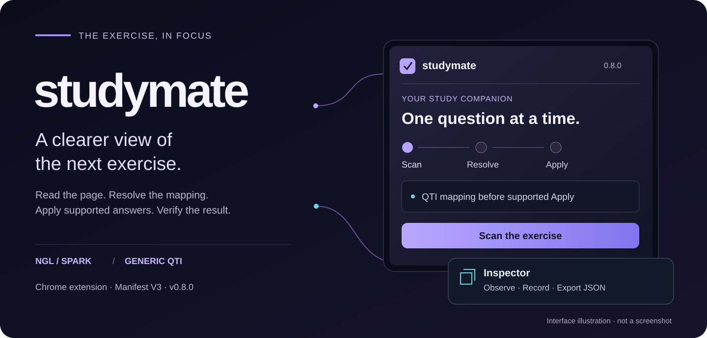
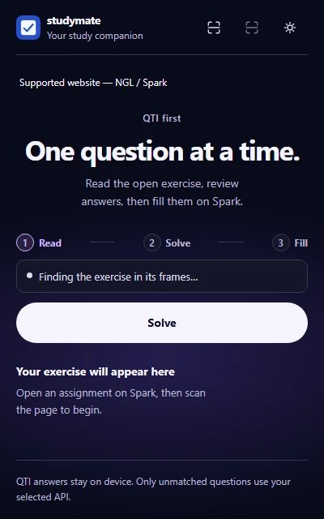
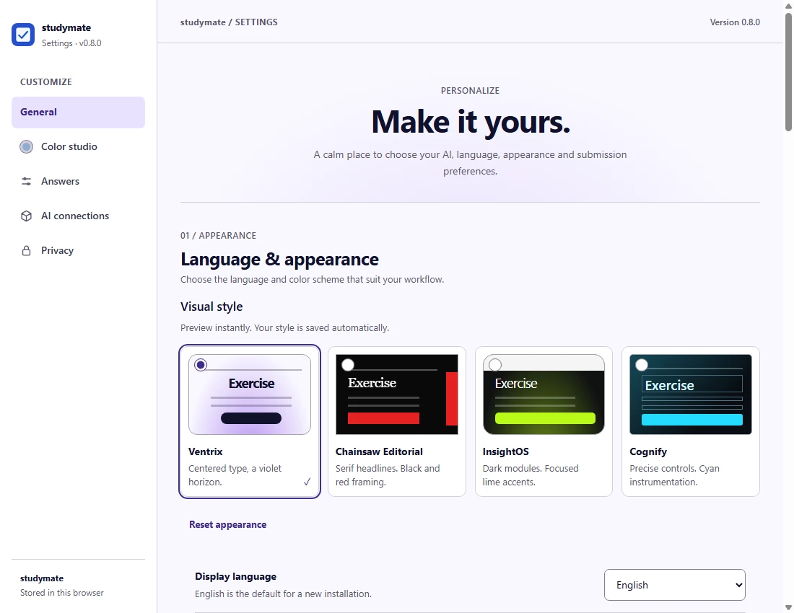
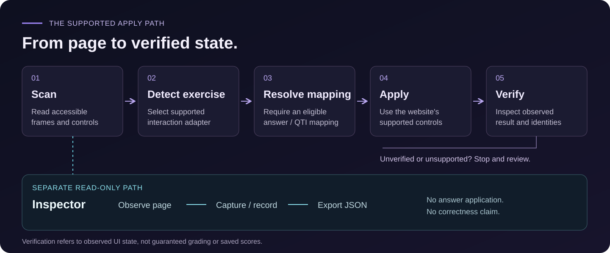
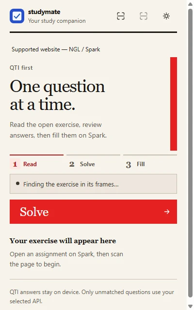
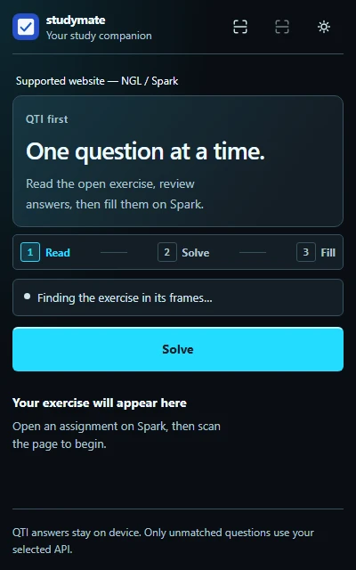
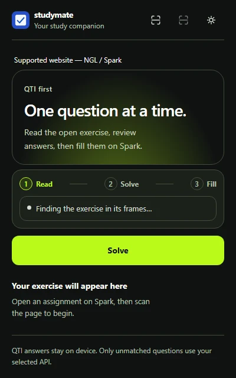
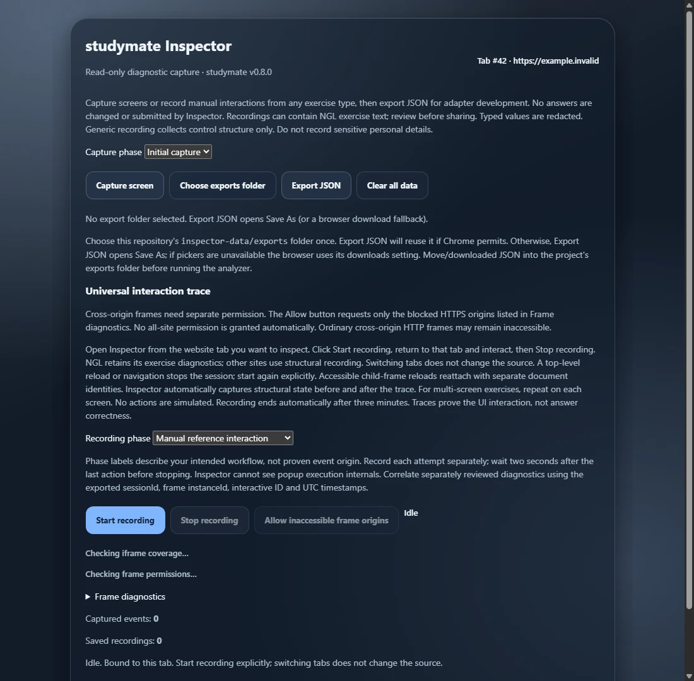

<p align="center"></p>
<h1 align="center">studymate</h1>
<p align="center"><strong>Xem bài. Áp dụng dựa trên bằng chứng.</strong></p>
<p align="center">
  
  
  
</p>
<p align="center"><a href="README.md">English</a> · <strong>Tiếng Việt</strong></p>
<p align="center"><a href="#interface">Giao diện</a> · <a href="#workflow">Quy trình</a> · <a href="#styles">Phong cách</a> · <a href="#inspector">Inspector</a> · <a href="#quick-start">Cài đặt</a> · <a href="#privacy">Riêng tư</a> · <a href="#development">Phát triển</a></p>

---

Tiện ích Chrome cho **NGL / Spark** và bài **QTI** tương thích. Quét trang, xem ánh xạ hiện có và áp dụng kết quả đủ điều kiện bằng điều khiển của website. Inspector riêng giúp thu thập bằng chứng khi cần điều tra tương tác.

> [!IMPORTANT]
> Hỗ trợ phụ thuộc cấu trúc bài và quyền truy cập. Checkbox và Linking Lines có giới hạn bên dưới. Ảnh local và test mô phỏng không chứng minh thành công trên website có đăng nhập hoặc điểm đã lưu.

<a id="interface"></a>
## Giao diện

<table>
<tr><th width="34%">Popup chính</th><th width="66%">Cài đặt</th></tr>
<tr><td valign="top"><a href="docs/images/popup.webp"><picture><source media="(prefers-color-scheme: light)" srcset="docs/images/popup-light.webp"></picture></a></td><td valign="top"><a href="docs/images/settings.webp"></a><p>Ngôn ngữ, giao diện, nhà cung cấp và tùy chọn chuyển bài ở cùng một nơi.</p></td></tr>
</table>

*Ảnh chụp UI thật từ source bằng Chrome với API tiện ích giả lập, không có dữ liệu người học. Popup ở trạng thái trống/đang quét. Đây không phải ảnh website có đăng nhập hay tiện ích đã cài. Nhấn để phóng to. UI và minh họa dùng tiếng Anh.*

<a id="workflow"></a>
## Từ quét đến xác minh trạng thái

<picture><source media="(max-width: 640px)" srcset="docs/images/workflow-mobile.svg"></picture>

Dừng để xem lại nếu không hỗ trợ hoặc chưa xác minh. Word Pool chạy **Trả hết → Xác nhận mọi ô trống → Điền → Kiểm tra ánh xạ**, cả với bài đã điền còn sửa được. Thay đổi từng phần có thể còn sau lỗi. Xác minh là trạng thái UI quan sát được, không bảo đảm điểm số.

<a id="features"></a>
## Khả năng hỗ trợ

| Khả năng | NGL / Spark | Bộ điều hợp Generic |
| --- | --- | --- |
| Nhận diện | Khung có quyền và widget nền tảng hỗ trợ | Điều khiển gốc trong nhóm bài rõ ràng |
| Nguồn đáp án | QTI hỗ trợ; dự phòng cấu hình tùy chọn | QTI nhúng tương thích với ID phản hồi duy nhất |
| Điền | Văn bản, dropdown, radio, chọn nhiều, sắp xếp, sửa từ | Input, select, radio, checkbox gốc; từ chối ánh xạ mơ hồ |
| Word Pool | Trả hết và điền lại qua điều khiển site hỗ trợ | Không hỗ trợ giao thức word-pool tùy biến |
| Checkbox | ID QTI và kiểm tra tập lựa chọn; popup có thể chặn đáp án chọn nhiều | Áp dụng checked-state gốc với ánh xạ tương thích |
| Linking Lines | Ánh xạ đầu nối, gửi thao tác; đồ thị cuối chưa xác minh | Không hỗ trợ widget nối tùy biến |
| Nộp bài | Nộp chủ động và chuyển trong hoạt động NGL có kiểm tra | Không nộp hay tự chuyển trang |

QTI XML / XML bọc JSON được phân tích có giới hạn, không thực thi script. Khai báo trên trang không tự chứng minh nguồn phát hành. NGL có thể dùng nhà cung cấp tương thích OpenAI hoặc quy tắc ngoại tuyến hạn chế; gợi ý Generic không đủ quyền Apply khi thiếu ánh xạ cục bộ cần thiết.

<a id="styles"></a>
## Bốn phong cách, bốn bố cục

<table>
<tr><th width="50%">Ventrix</th><th width="50%">Chainsaw Editorial</th></tr>
<tr><td align="center"><a href="docs/images/popup.webp"></a></td><td align="center"><a href="docs/images/style-editorial.webp"></a></td></tr>
<tr><th>Cognify</th><th>InsightOS</th></tr>
<tr><td align="center"><a href="docs/images/style-cognify.webp"></a></td><td align="center"><a href="docs/images/style-insightos.webp"></a></td></tr>
</table>

Chọn phong cách trong **Cài đặt**, tự lưu. Có theme sáng, tối, theo hệ thống. Ngôn ngữ UI: Anh, Việt, Trung giản thể, Trung phồn thể. Giao diện không thay đổi khả năng giải.

<a id="inspector"></a>
## Quan sát bằng Inspector

<details>
<summary><strong>Mở ảnh xem trước Inspector</strong></summary>

<a href="docs/images/inspector.webp"></a>

*Ảnh UI local, không phải bản ghi live. Nguồn là domain giả dành riêng example.invalid. Không hiển thị đáp án, credentials hoặc định danh phiên.*

</details>

1. Mở Inspector từ đúng tab nguồn, kiểm tra phạm vi khung.
2. Chụp trạng thái hoặc ghi thao tác thủ công; dừng và xem cảnh báo phạm vi/cắt dữ liệu.
3. Xuất JSON. Chọn `inspector-data/exports` khi có trình chọn thư mục; nếu không, dùng Save As/cài đặt tải xuống rồi chép vào đó.

Inspector chỉ đọc: không giải, nộp hoặc xác nhận đúng. Ghi có giới hạn, dừng sau ba phút hoặc khi điều hướng trang chính. Khung khác origin và thư mục xuất có thể cần cấp lại quyền.

Phân tích local tùy chọn: `node .\tools\analyze-inspector.cjs`. Reports/prompts chỉ là đề xuất cho bước phát triển được cho phép riêng. [Quy trình](inspector-data/README.md) · [Universal Inspector](docs/UNIVERSAL_INSPECTOR.md) · [Bằng chứng chi tiết](docs/inspector-deep.md)

---

<a id="quick-start"></a>
## Cài đặt và sử dụng

**Chrome + thư mục source. Runtime không cần build hay cài dependency.** Tải source ZIP hoặc clone:

```powershell
git clone https://github.com/imnwngr/studymate.git
Set-Location studymate
```

1. Mở `chrome://extensions`, bật **Developer mode**, chọn **Load unpacked** và thư mục chứa `manifest.json`.
2. Mở bài, mở studymate, chọn **Quét bài**, kiểm tra khung rồi **Giải bài**.
3. Xem kết quả thực tế. Đợi Word Pool trả hết và điền xong trước khi thao tác tiếp.
4. Chỉ dùng **Hoàn tất và tiếp tục** khi nút bật và bạn muốn nộp. NGL có thể chuyển màn hình trong hoạt động sau kiểm tra; nút thay đổi không chứng minh điểm đã lưu.

**Cập nhật:** pull source, reload tiện ích, làm mới tab bài. Nếu thư mục đã đổi tên, load vị trí mới và kiểm tra quyền/cài đặt. Version 0.8.0 không ngụ ý có Chrome Web Store hoặc GitHub Release.

<a id="privacy"></a>
## Riêng tư, quyền và giới hạn

| Quyền | Mục đích |
| --- | --- |
| `activeTab`, `scripting`, `webNavigation` | Truy cập do người dùng yêu cầu, chèn script có quyền và tìm khung |
| `storage` | Cấu hình cục bộ, không phải kho bí mật bảo vệ tuyệt đối |
| Host khai báo | NGL, khung Avallain và origin API OpenAI |
| HTTPS / localhost tùy chọn | Endpoint/khung được cho phép; khai báo không tự cấp quyền |

API gửi câu hỏi/lựa chọn tới nhà cung cấp đã cấu hình, có thể phát sinh phí; ngoại tuyến không gọi nhà cung cấp. Inspector không chủ động đọc cookie, kho xác thực hay mô hình ứng dụng. Giá trị nhập được che, nhưng nội dung NGL, đáp án chọn, ID DOM, tiêu đề và đường dẫn URL có thể còn. Một số chẩn đoán lỗi Solve có thể chứa đáp án. **Kiểm tra export/log trước chia sẻ.**

<details>
<summary><strong>Giới hạn đã biết và dữ liệu local</strong></summary>

- Popup Checkbox có thể chặn một số đáp án chọn nhiều trước Apply.
- Linking Lines không xác minh chính xác kết nối cuối; kiểm tra thủ công.
- Nhiều khung bài có thể mơ hồ. Generic từ chối widget không hỗ trợ/tùy biến, thiếu ánh xạ hoặc DOM cũ.
- Không truy cập được trang trình duyệt bị hạn chế và Shadow DOM đóng.
- Trả Word Pool và trạng thái ứng dụng giữ lại cần retest có đăng nhập cho bài cụ thể. Test mô phỏng không chứng minh site thật.
- Không đưa recordings, reports, prompts, browser profiles, credentials và artifacts riêng tư vào Git/gói chia sẻ. Ignore không phải chính sách ZIP an toàn.
- Tên schema/export cũ, storage key và hợp đồng `SPARK_*` giữ tương thích; NGL / Spark là nền tảng bên ngoài.

</details>

<a id="development"></a>
## Phát triển

<details>
<summary><strong>Cấu trúc dự án và lệnh kiểm thử</strong></summary>

```text
studymate/
├── core/ · adapters/        Điều phối khung/runtime và adapter site
├── answer-sources/         Tích hợp QTI nhúng
├── solvers/                Bộ giải tương tác dùng chung
├── popup.* · options.*     Luồng bài và Cài đặt
├── inspector*.js           Capture/export chỉ đọc
├── tests/ · tools/         Kiểm thử và phân tích local
└── docs/ · inspector-data/ Tài liệu và bằng chứng local riêng tư
```

Test Node không cần npm package. Fixture browser cần Chrome/Chromium đã cài; runner hỗ trợ nhận `SPARK_BROWSER`. Runner Python tùy chọn cần Python và Playwright.

```powershell
node --test --test-isolation=none tests/*.test.js tests/*.test.cjs
node tests/run-browser-wordpool.cjs
node tests/run-browser-multisite.cjs
node tests/run-browser-inspector-universal.cjs
node tests/run-browser-linking.cjs
```

Test bằng chứng riêng tư có thể skip khi thiếu fixture; một số kiểm tra cần audit file bị ignore. Xem [kiến trúc](docs/MULTISITE_ARCHITECTURE.md) và [nguồn gốc hình ảnh](docs/images/README.md). Bảo toàn thay đổi không liên quan; phân biệt test mô phỏng và kiểm tra có đăng nhập.

</details>

---

[Kho mã nguồn](https://github.com/imnwngr/studymate) · [Changelog](CHANGELOG.md) · [English](README.md)

Không có tệp giấy phép độc lập. Tài liệu không cấp thêm quyền phân phối.
